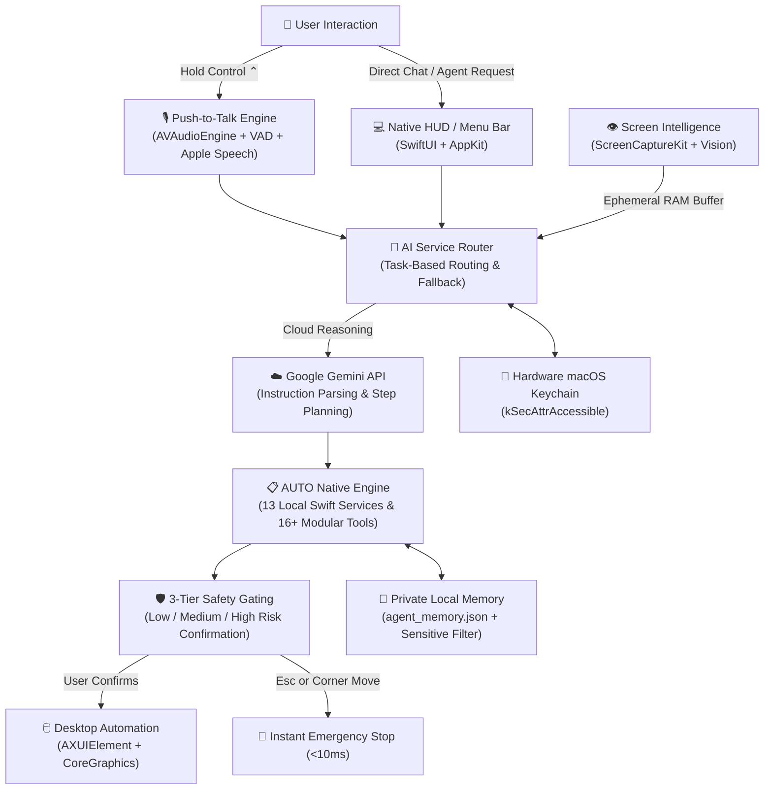

<p align="center">
  
</p>

<h1 align="center">AUTO</h1>

<p align="center">
  <b>Your Personal AI Desktop Companion</b><br/>
  <i>100% Native macOS • Push-to-Talk Voice • Visual Screen Intelligence • Autonomous Desktop Guidance</i>
</p>

<p align="center">
  <a href="#-key-features"></a>
  <a href="#-system-architecture"></a>
  <a href="#-84-automated-tests"></a>
  <a href="#-download--installation"></a>
  <a href="#-security--privacy-guarantees"></a>
</p>

<p align="center">
  <a href="#-interactive-demo--quick-tour"><b>Quick Tour</b></a> •
  <a href="#-key-features"><b>Key Features</b></a> •
  <a href="#-system-architecture"><b>Architecture</b></a> •
  <a href="#-keyboard-shortcuts--controls"><b>Controls</b></a> •
  <a href="#-download--installation"><b>Download</b></a> •
  <a href="#-84-automated-tests"><b>Test Suite</b></a> •
  <a href="#-privacy--security"><b>Privacy & Safety</b></a> •
  <a href="docs/ARCHITECTURE.md"><b>Documentation</b></a>
</p>

---

## 💡 What is AUTO?

**AUTO** is an independent, native macOS desktop companion inspired by the open-source [HeyClicky](https://github.com/farzaa/clicky) reference. Built from the ground up in **Swift, SwiftUI, AppKit, ScreenCaptureKit, Accessibility APIs, and AVFoundation**, AUTO lives seamlessly on your Mac as a menu-bar accessory, floating HUD companion, and multi-display transparent overlay.

Unlike heavy, web-wrapped AI assistants that consume gigabytes of RAM, AUTO is lightweight (~80MB RAM), executes local workflows in under 50ms, respects your screen privacy with ephemeral RAM-only captures, and never charges subscription fees.

```text
┌────────────────────────────────────────────────────────────────────────┐
│  ✨ 100% Free Forever     🛡️ Zero Telemetry        🔑 macOS Keychain    │
│  🚫 No Subscriptions      ⚡ Swift 6 Concurrency   🖥️ Native AppKit     │
└────────────────────────────────────────────────────────────────────────┘
```

---

## 🗺️ System Architecture

AUTO connects voice input, visual desktop understanding, autonomous task planning, and accessibility automation into a cohesive, safety-gated execution loop:



---

## 🌟 Key Features

<details open>
<summary><b>1. 🎙️ Natural Voice Engine & Hold-Control Push-to-Talk (Click to expand)</b></summary>
<br/>

- **Global Hotkey Interaction**: Hold the **Control (⌃)** key from any app, full-screen game, or desktop space to speak naturally with AUTO.
- **Real-Time Voice Activity Detection (VAD)**: Dynamic RMS metering visualizes live audio waves in the HUD companion panel.
- **Natural AI Speech & Instant Interruption**: High-clarity TTS output via `AVSpeechSynthesizer`. Start speaking or tap `Control` again to instantly interrupt AUTO mid-sentence without lag.
- **Hardware Agnostic**: Automatic input switching across built-in Mac mics, AirPods, and studio USB interfaces.

</details>

<details>
<summary><b>2. 👁️ Multi-Monitor Visual Screen Intelligence (Click to expand)</b></summary>
<br/>

- **Full Display & Window Understanding**: Uses Apple's ultra-low-latency **ScreenCaptureKit** to capture the active monitor, secondary displays, or targeted application windows.
- **Retina Coordinate Transforms**: Intelligently handles multi-display setups, Retina HiDPI scale factors, and negative virtual coordinate spaces.
- **RAM-Only Ephemeral Processing**: Screenshots are downsampled in memory, encoded into JPEG payloads for Gemini visual reasoning, and purged from RAM immediately. Zero images are ever written to disk.

</details>

<details>
<summary><b>3. 🖱️ Permission-Based Desktop Automation & Cursor Guidance (Click to expand)</b></summary>
<br/>

- **Accessibility Object Model**: Navigates user interface hierarchies using macOS `AXUIElement` APIs to locate buttons, text fields, menu items, tabs, and tables.
- **Natural Language Element Matching**: Fuzzy string matching, token scoring, and ambiguity detection ensure AUTO targets the exact control intended.
- **Human-like Bezier Cursor Trajectories**: Simulates natural, smooth cursor movement and hardware clicks without abrupt pointer jumps.
- **3-Tier Safety Gating**: Non-destructive interactions execute autonomously; high-risk operations (submitting forms, moving folders, modifying files) trigger an interactive confirmation dialog.
- **Instant Emergency Stop**: Move the cursor to any screen corner or press <kbd>Esc</kbd> to kill all automation within 10 milliseconds.

</details>

<details>
<summary><b>4. 🤖 Autonomous Agent & Multi-Step Task Planning (Click to expand)</b></summary>
<br/>

- **Hierarchical Task Planner**: Automatically deconstructs multi-stage instructions (*"Open Safari, download the quarterly report, and summarize findings in Notes"*) into sequential, dependency-checked sub-tasks.
- **16+ Built-in Tools**: Across 6 specialized categories:
  - `conversation`: Text response, query clarification, voice response.
  - `screenIntelligence`: Multi-monitor capture, window inspection, visual OCR.
  - `desktopAutomation`: Click, double-click, right-click, smooth drag, keyboard type, hotkey dispatch.
  - `applicationContext`: Frontmost app discovery, running process inventory, window bounds.
  - `memory`: Local key-value store, preference retrieval, category search.
  - `localFiles`: Safe directory listing, text preview, sandboxed organization (`~/Desktop`, `~/Downloads`, `~/Documents`).

</details>

<details>
<summary><b>5. 🧠 Private Persistent Local Memory (Click to expand)</b></summary>
<br/>

- **Strictly Local JSON Storage**: Preferences, past context, and custom workflows are stored at `~/Library/Application Support/AUTO/agent_memory.json`.
- **Sensitive Credential Firewall**: Automatically detects, blocks, and refuses to store passwords, bearer tokens, API keys, and credit card numbers.
- **Multi-Turn Context Compaction**: Automatically summarizes historical conversation turns so context stays focused without exceeding token limits.
- **Granular Purge Controls**: One-click purge buttons for conversation history, memory categories, or complete factory reset.

</details>

<details>
<summary><b>6. ⚡ Hybrid AI Architecture: Gemini Reasoning + Native Local Swift Engine (Click to expand)</b></summary>
<br/>

- **Cloud Reasoning**: Google Gemini API (`gemini-2.5-flash` / `gemini-2.5-pro`) providing high-speed natural language understanding, intent parsing, and step planning.
- **Local Native Engine**: 13 local Swift services handling 100% of desktop execution, ScreenCaptureKit, on-device Apple Vision OCR, and SQLite persistent storage.
- **Hardware-Backed Keychain**: All API keys are encrypted in Apple's hardware Secure Enclave / Keychain services with `kSecAttrAccessibleWhenUnlockedThisDeviceOnly`.

</details>

---

## ⚡ Comparison: Native Swift vs. Electron Assistants

| Architectural Feature | **AUTO (Native macOS)** | Typical Electron / Web Assistants |
|---|---|---|
| **Programming Language** | **Swift 6 + SwiftUI + AppKit** | JavaScript / TypeScript / Node.js |
| **Idle Memory Footprint** | **~60 – 85 MB RAM** | 500 MB – 1.4 GB RAM |
| **Binary Package Size** | **16 MB** (`AUTO.app`) | 180 MB – 450 MB |
| **Push-to-Talk Latency** | **< 40ms** (Native `AVAudioEngine`) | 250ms – 600ms (WebAudio / Chromium) |
| **Display Capture Engine** | **ScreenCaptureKit** (Hardware GPU) | Slow desktopCapturer screenshots |
| **UI Automation** | **Direct `AXUIElement` & CGS** | Flaky CDP / Puppeteer / Accessibility wrappers |
| **Telemetry & Trackers** | **0 (Zero Telemetry)** | Mixpanel, Segment, Sentry, Datadog |
| **Pricing Policy** | **100% Free Forever** | \$20/month subscription or credit packs |

---

## ⌨️ Keyboard Shortcuts & Controls

| Shortcut | Scope | Action |
|---|---|---|
| <kbd>Control (Hold)</kbd> | Global | **Push-to-Talk**: Hold to speak; release to transmit & receive AI response |
| <kbd>Escape</kbd> | Global | **Emergency Stop**: Instantly aborts any active agent task or cursor movement |
| **Corner Mouse Gesture** | Global | **Failsafe Stop**: Slam cursor into any screen corner to halt automation |
| <kbd>Cmd</kbd> + <kbd>,</kbd> | In-App | Open Unified Permissions, Model Settings & Privacy Hub |
| <kbd>Cmd</kbd> + <kbd>Q</kbd> | In-App | Safely quit AUTO and release all audio/display streams |

---

## 🚀 Download & Installation

### Option 1: Mount Pre-Built Disk Image (.dmg)
1. Download [`AUTO-1.0.0.dmg`](https://github.com/ketanbaba2006/AUTO/releases/download/v1.0.0/AUTO-1.0.0.dmg) (11 MB).
2. Double-click to mount the DMG, then drag **AUTO** into `/Applications`.
3. Open `AUTO` from `/Applications`.
   > **Note on Gatekeeper**: Because AUTO is distributed independently with an ad-hoc signature, macOS will present a security prompt on first launch. Right-click `AUTO.app` > choose **Open** > click **Open** to approve.

### Option 2: Build From Source (Swift Package Manager)

Requirements: macOS 14.0+, Xcode 15+ / Swift 6.0 toolchain.

```bash
# 1. Clone repository
git clone https://github.com/ketanbaba2006/AUTO.git
cd AUTO

# 2. Run the offline test suite (84 automated tests)
swift build
./.build/debug/AUTO --test

# 3. Launch native companion application
swift run AUTO
```

### Option 3: Package Official Standalone .app and .dmg
```bash
bash scripts/package_app.sh
```
Assembles `dist/AUTO.app` (16 MB) and generates `dist/AUTO-1.0.0.dmg` (11 MB).

---

## 🧪 84 Automated Tests

AUTO includes an extensive test suite verifying every component without network requirements:

```bash
swift run AUTO --test
```

<details>
<summary><b>Click to expand full 84-test execution breakdown</b></summary>
<br/>

```text
=======================================================
    AUTO AUTOMATED TEST SUITE (FRAGMENT 7: RELEASE)   
=======================================================

  [PASS] Gemini Connection Testing (Mocked)
  [PASS] Gemini Model Discovery (Parsing)
  [PASS] Gemini Generate & Spatial Points & Tokens
  [PASS] Gemini 403 Auth Error Mapping
  [PASS] Gemini 429 Rate Limit Error Mapping
  [PASS] Gemini Intent Interpretation & Structured Actions
  [PASS] Local Action Validation & Bounds Clamping
  [PASS] Local Apple Vision OCR Engine
  [PASS] SpatialPoint Regex Point Parsing
  [PASS] PromptManager Template Generation
  [PASS] ConversationMemory History Limits & Pruning
  [PASS] Task-Based AI Routing Resolution
  [PASS] Local Offline Behavior & Fixed Commands
  [PASS] ImageProcessor Screenshot Compression
  [PASS] Mock Keychain Storage & Deletion
  [PASS] Push-to-Talk Press and Release Detection
  [PASS] Push-to-Talk Duplicate Event Suppression
  [PASS] Voice State Machine Transitions
  [PASS] Assistant Speech Interruption Handling
  [PASS] Voice Activity Detector RMS Calculation
  [PASS] Microphone Device Discovery
  [PASS] Speech Output Text Sanitization
  [PASS] Empty Speech Recognition Graceful Handling
  [PASS] Official Brand Theme & Identity Constants
  [PASS] Brand Asset Resolution & Image Caching
  [PASS] Menu Bar Mascot Vector Icon Template Rendering
  [PASS] Screen Capture Permission State Handling
  [PASS] ScreenshotProcessor 4K Downsampling & JPEG Legibility
  [PASS] Multi-Display Negative Virtual Coordinates Mapping
  [PASS] WindowInfo Metadata Filtering and Ordering
  [PASS] ScreenContextManager Lifecycle & Memory Purge
  [PASS] Accessibility Visual Context Hierarchy Summary
  [PASS] Screen Awareness Mode and Capture State Transitions
  [PASS] Gemini Multimodal Vision Payload Request Construction
  [PASS] Coordinate Mapper Bounds and Clamping
  [PASS] Multi-Display Negative Coordinate Mapping V2
  [PASS] Screenshot Pixel to Desktop Coordinate Mapping
  [PASS] Window-Relative to Global Coordinate Mapping
  [PASS] Element Locator Exact & Fuzzy Scoring
  [PASS] Element Locator Ambiguity Detection
  [PASS] Structured Action Proposal Parser from AI
  [PASS] High-Risk Action Confirmation Gating
  [PASS] High-Risk Action Cancellation/Rejection
  [PASS] MouseActionManager Mock Event Pipeline
  [PASS] MouseActionManager Safe Button State Release
  [PASS] KeyboardActionManager Mock Keystroke Pipeline
  [PASS] KeyboardActionManager Destructive Command Interception
  [PASS] Emergency Stop Instant Failsafe & Latch Reset
  [PASS] Action Verification Manager Outcome Evaluation
  [PASS] Action History Recording & Memory Clearing
  [PASS] Prompt Injection Defense in System Templates
  [PASS] Task Planner Multi-Step Plan Generation
  [PASS] Task Plan Step Dependencies and Progress
  [PASS] Tool Registry Built-in Tool Catalog
  [PASS] Tool Dispatcher Synchronous/Async Execution
  [PASS] Tool Dispatcher Missing Tool & Error Handling
  [PASS] Agent Permission Manager Validation
  [PASS] Agent Task Status Lifecycle Transitions
  [PASS] Agent Orchestrator Task Initiation & Pause
  [PASS] Agent Orchestrator Task Cancellation
  [PASS] Task Executor Step Execution Pipeline
  [PASS] Agent Safety Manager Approval Gating
  [PASS] Agent Safety Manager Approval Request Details
  [PASS] Prompt Injection External Content Sanitizer
  [PASS] Local Memory Storage and Key Updates
  [PASS] Local Memory Category Partitioning and Querying
  [PASS] Local Memory Search and Relevance Ranking
  [PASS] Local Memory Sensitive Data Rejection
  [PASS] Local Memory Disabled Storage Policy
  [PASS] Memory Retrieval Manager Task Grounding
  [PASS] Conversation Summarizer Multi-Turn Compaction
  [PASS] Local File Manager Directory Listing and Path Guard
  [PASS] Unified Permission Hub Refresh and Query
  [PASS] Speech Recognition Permission Configuration
  [PASS] Notification Permission Configuration
  [PASS] Privacy Data Purge Granular Isolation
  [PASS] Privacy Master Purge Keychain and State
  [PASS] Onboarding Steps and State Transitions
  [PASS] App Lifecycle Power State Handling
  [PASS] Concurrent AI Request Cancellation
  [PASS] End-to-End Voice to Agent Task Pipeline
  [PASS] System Information & Brand Bundle Integrity
  [PASS] Keychain Key Replacement and Revocation
  [PASS] Hardware Release Failsafe on Emergency Stop

-------------------------------------------------------
TOTAL: 84 | PASSED: 84 | FAILED: 0 | SKIPPED: 0
=======================================================
```

</details>

---

## 🔒 Security & Privacy Guarantees

| Security Layer | Technical Enforcement |
|---|---|
| **API Key Storage** | Stored in hardware **macOS Keychain** using `kSecAttrAccessibleWhenUnlockedThisDeviceOnly`. |
| **Screen Privacy** | Captured frames are held in volatile RAM, downsampled for multimodal inference, and destroyed immediately. No screenshots are saved to disk. |
| **Zero Telemetry** | Contains zero third-party trackers, analytics endpoints, or remote logging services. |
| **Memory Firewall** | Regex filters inspect local memory candidates and reject passwords, bearer tokens, and private keys. |
| **Filesystem Sandbox** | File manipulation tools are restricted to `~/Desktop`, `~/Downloads`, and `~/Documents`. Root directories (`/`, `/System`, `/etc`, `~/.ssh`) are strictly barred. |

---

## 🌐 Website & Download Portal

AUTO includes a fully responsive modern web application located in the `website/` directory, built with **Vite 6, React 19, TypeScript, and Lucide React**:

- Live interactive views: Home, Features, Download, Privacy Policy, Documentation Hub, About, and Changelog.
- Static production build compiles in ~380ms into `website/dist/`.
- Ready for one-click deployment to **Cloudflare Pages, Vercel, Netlify, or GitHub Pages**. See [`docs/WEBSITE_DEPLOYMENT.md`](docs/WEBSITE_DEPLOYMENT.md).

---

## 📚 Technical Documentation Hub

- [Architecture Guide](docs/ARCHITECTURE.md) — Comprehensive technical overview of all 7 layers.
- [Voice & Push-to-Talk Setup](docs/VOICE_SETUP.md) — Audio pipeline, VAD, and hotkey configuration.
- [Screen Intelligence](docs/SCREEN_INTELLIGENCE.md) — ScreenCaptureKit and coordinate normalization.
- [Cursor Intelligence & Automation](docs/CURSOR_INTELLIGENCE.md) — Accessibility tree inspection and mouse events.
- [Task Planning & Agent](docs/TASK_PLANNING.md) — Multi-step decomposition and tool dispatcher.
- [Tool Execution Architecture](docs/TOOL_EXECUTION.md) — Built-in 16-tool registry catalog and safety tiers.
- [Security Threat Model](docs/SECURITY.md) — Threat boundaries, injection defense, and credential hygiene.
- [Privacy Policy](docs/PRIVACY.md) — Transparent disclosure of local vs. remote processing.
- [Website Deployment](docs/WEBSITE_DEPLOYMENT.md) — Cloudflare, Vercel, Netlify, and GitHub Pages guide.
- [Code Signing & Notarization](docs/CODE_SIGNING.md) — Apple Developer ID signing and `notarytool` guide.

---

## 🤝 Contributing

Contributions to AUTO are warmly welcomed! Please read our [Contributing Guidelines](CONTRIBUTING.md) before submitting pull requests.

1. Fork the Project.
2. Create your Feature Branch (`git checkout -b feature/NewCapability`).
3. Verify all 84 tests pass (`swift run AUTO --test`).
4. Commit your changes (`git commit -m 'feat: add new capability'`).
5. Push to the Branch (`git push origin feature/NewCapability`).
6. Open a Pull Request.

---

## 📄 License & Acknowledgements

- **Attribution**: Architectural interaction patterns inspired by the open-source [HeyClicky](https://github.com/farzaa/clicky) reference project created by Farza.
- **License**: See [LICENSE](LICENSE) for details.
- **Brand Identity**: Official AUTO Mascot and Logo are proprietary to the AUTO project.

<p align="center">
  <b>Built with ❤️ for macOS power users. Enjoy your personal AI desktop companion!</b>
</p>
