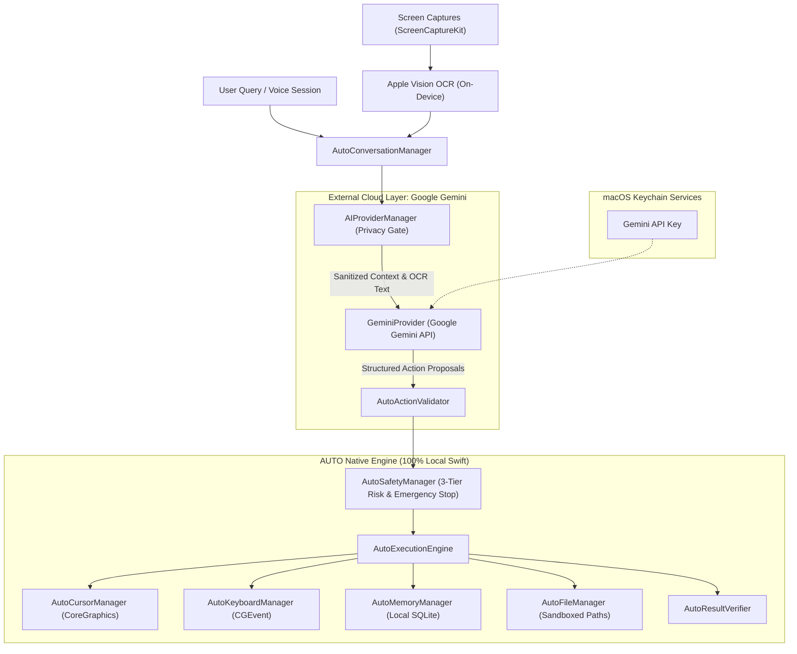

# AUTO AI Architecture: Hybrid Reasoning & Local Native Engine

## 1. Overview

AUTO operates a unified **Hybrid AI Architecture** designed around strict domain separation:
- **Cloud Reasoning Layer**: Google Gemini API (`https://generativelanguage.googleapis.com/v1beta`)
- **Local Native Engine**: 13 Native Swift Services running directly on macOS

Google Gemini handles high-level cognitive operations (natural language understanding, multi-turn dialogue, task decomposition, and structured action proposals). The AUTO Native Engine executes all physical desktop actions, screen capture, on-device Apple Vision OCR, SQLite memory storage, and safety enforcement locally.



---

## 2. Core Protocols and Abstractions

### 2.1 `AIProvider` Protocol
Located in [`AUTO/AI/AIProvider.swift`](file:///Users/ketanbaba/Desktop/Extra/AUTO/AUTO/AI/AIProvider.swift):
```swift
public protocol AIProvider: AnyObject, Sendable {
    var providerType: AIProviderType { get }
    var isConfigured: Bool { get }
    func testConnection() async throws -> Bool
    func fetchAvailableModels() async throws -> [AIModelInfo]
    func generateResponse(messages: [AIMessage], context: AIRequestContext) async throws -> AICompletionResponse
    func streamResponse(messages: [AIMessage], context: AIRequestContext) -> AsyncThrowingStream<String, Error>
}
```

### 2.2 `AIProviderService` & Central Manager
Located in [`AUTO/AI/AIProviderManager.swift`](file:///Users/ketanbaba/Desktop/Extra/AUTO/AUTO/AI/AIProviderManager.swift), `AIProviderManager` coordinates:
1. Dynamic Gemini model discovery and caching.
2. Connection verification.
3. Zero-Screenshot Privacy Gating (OCR text sent by default; screenshot transmission requires explicit user toggle).
4. Token usage tracking and error mapping.

---

## 3. Google Gemini Provider Implementation

The Gemini integration is implemented in [`AUTO/AI/GeminiProvider.swift`](file:///Users/ketanbaba/Desktop/Extra/AUTO/AUTO/AI/GeminiProvider.swift).

### 3.1 Endpoints
- **Model Discovery**: `GET https://generativelanguage.googleapis.com/v1beta/models?key={apiKey}`
- **Content Generation**: `POST https://generativelanguage.googleapis.com/v1beta/models/{modelId}:generateContent?key={apiKey}`
- **SSE Streaming**: `POST https://generativelanguage.googleapis.com/v1beta/models/{modelId}:streamGenerateContent?alt=sse&key={apiKey}`

### 3.2 Supported Models
- **`gemini-2.5-flash`** (Default): Fast, multimodal, ultra-responsive model optimized for real-time desktop interactions.
- **`gemini-2.5-pro`**: High-capacity reasoning model for complex multi-step workflows.
- **`gemini-2.0-flash`**: High-speed conversational fallback.

### 3.3 Token Usage Tracking
Gemini's `usageMetadata` (`promptTokenCount`, `candidatesTokenCount`, `totalTokenCount`) is decoded and published via `ApplicationState.shared.lastTokenUsage` for live visibility in Settings.

---

## 4. Privacy & Zero-Screenshot Transmission

By default, AUTO does NOT upload raw screenshot pixels to the cloud:
1. `AutoScreenManager` captures display buffers locally via `ScreenCaptureKit`.
2. Apple Vision framework (`VNRecognizeTextRequest`) extracts text and element bounding boxes locally on the Apple Silicon Neural Engine.
3. The extracted text structure is provided to Gemini.
4. If the user explicitly enables **Allow Screenshot Transmission** in Settings, downsampled JPEG captures (70% quality, max dimension 1920px) are transmitted over TLS for multimodal vision analysis.

---

## 5. Local Execution Guarantee

No cloud model is ever permitted to execute shell scripts, send raw keyboard events, or click UI elements autonomously:
- All proposals pass through `AutoActionValidator` to enforce coordinate bounds on active `NSScreen` instances.
- Destructive and High-Risk operations are gated by `AutoSafetyManager` requiring explicit human modal approval.
- An instantaneous Emergency Stop (<10ms) releases all hardware inputs immediately if the user taps ESC or types `abort`.
