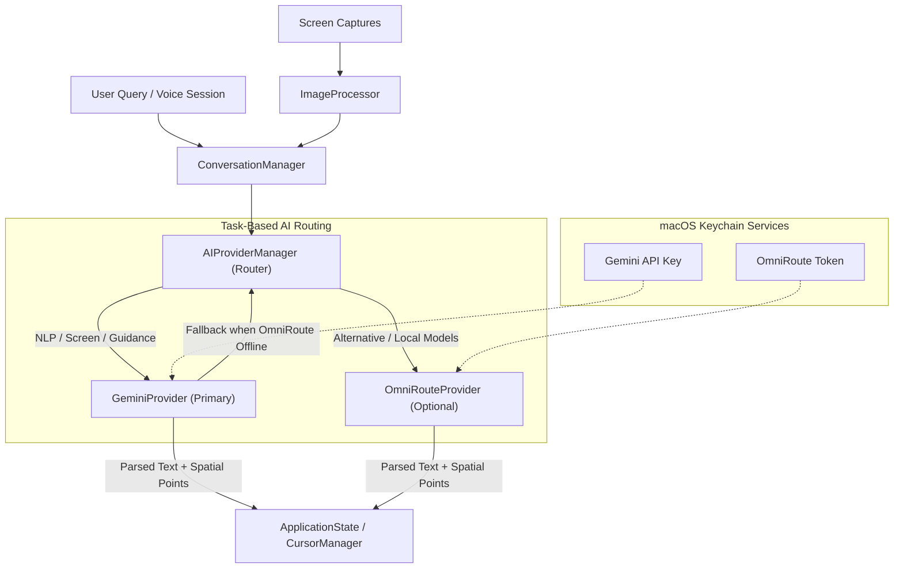

# AUTO AI Architecture: Dual Provider & Task Routing (Fragment 2)

## 1. Overview

AUTO operates a decoupled, protocol-oriented AI infrastructure designed around two complementary systems:
- **Primary Engine**: Google Gemini API (`https://generativelanguage.googleapis.com/v1beta`)
- **Optional Gateway**: OmniRoute API Gateway (`http://localhost:20128/v1` or remote endpoints)

This design ensures AUTO remains fully functional as a desktop companion out-of-the-box using Google Gemini, while giving power users and developers the freedom to route queries or specific tasks to local or private models hosted via OmniRoute.



---

## 2. Core Protocols and Abstractions

### 2.1 `AIProvider` Protocol
Located in [`AUTO/AI/AIProvider.swift`](file:///Users/ketanbaba/Desktop/Extra/AUTO/AUTO/AI/AIProvider.swift), all AI providers implement:
```swift
public protocol AIProvider: AnyObject, Sendable {
    var providerType: AIProviderType { get }
    var isConfigured: Bool { get }
    func testConnection() async throws -> Bool
    func fetchAvailableModels() async throws -> [AIModelInfo]
    func generateResponse(messages: [AIMessage], context: AIRequestContext) async throws -> AICompletionResponse
    func streamResponse(messages: [AIMessage], context: AIRequestContext) -> AsyncThrowingStream<String, Error>
}
```

### 2.2 `AIProviderService` & Central Manager
Located in [`AUTO/AI/AIProviderManager.swift`](file:///Users/ketanbaba/Desktop/Extra/AUTO/AUTO/AI/AIProviderManager.swift), `AIProviderManager` coordinates:
1. Dynamic model discovery.
2. Connection verification.
3. Task-based request routing.
4. Automatic fallback from OmniRoute to Gemini when local servers are offline.
5. Multimodal screenshot downsampling and preparation.

---

## 3. Google Gemini Provider Implementation

The Gemini integration is implemented in [`AUTO/AI/GeminiProvider.swift`](file:///Users/ketanbaba/Desktop/Extra/AUTO/AUTO/AI/GeminiProvider.swift).

### 3.1 Endpoints
- **Model Discovery**: `GET https://generativelanguage.googleapis.com/v1beta/models?key={apiKey}`
- **Content Generation**: `POST https://generativelanguage.googleapis.com/v1beta/models/{modelId}:generateContent?key={apiKey}`
- **SSE Streaming**: `POST https://generativelanguage.googleapis.com/v1beta/models/{modelId}:streamGenerateContent?alt=sse&key={apiKey}`

### 3.2 Multimodal Payload Structure
Screenshots are compressed to JPEG (quality: 0.75, max dimension 1536px) by `ImageProcessor` and attached using Gemini's native `inline_data` specification:
```json
{
  "contents": [
    {
      "role": "user",
      "parts": [
        { "text": "What application is in the background?" },
        {
          "inline_data": {
            "mime_type": "image/jpeg",
            "data": "<BASE64_JPEG_STRING>"
          }
        }
      ]
    }
  ],
  "systemInstruction": {
    "parts": [{ "text": "You are AUTO, an intelligent native macOS desktop companion..." }]
  },
  "generationConfig": {
    "temperature": 0.7,
    "maxOutputTokens": 2048
  }
}
```

### 3.3 Token Usage Tracking
Gemini's `usageMetadata` object (`promptTokenCount`, `candidatesTokenCount`, `totalTokenCount`) is decoded and exposed via `ApplicationState.shared.lastTokenUsage` for live visibility in Settings.

---

## 4. OmniRoute Gateway Integration

The OmniRoute client is implemented in [`AUTO/AI/OmniRouteProvider.swift`](file:///Users/ketanbaba/Desktop/Extra/AUTO/AUTO/AI/OmniRouteProvider.swift).

### 4.1 Connection Profiles
Users can configure multiple profiles (e.g., Local Gateway, Home Lab, Remote Host):
```swift
public struct OmniRouteProfile: Identifiable, Codable, Equatable, Sendable {
    public var id: UUID
    public var name: String
    public var baseURL: String // default: http://localhost:20128/v1
    public var apiKeyAccount: String
    public var connectionType: ConnectionType // .local or .remote
    public var isEnabled: Bool
    public var defaultModel: String
    public var lastConnectionStatus: String?
}
```

### 4.2 OpenAI-Compatible API Support
- Model discovery queries `GET /v1/models` with Bearer auth.
- Chat completions queries `POST /v1/chat/completions` with streaming SSE support (`data: [DONE]`).

---

## 5. Task-Based Routing Rules

Users can configure AI routing per task in Settings > AI Routing:
| Task (`AITaskType`) | Default Provider | Fallback Strategy |
| :--- | :--- | :--- |
| **Natural Language Processing** | Google Gemini | None (Primary) |
| **Screen Understanding** | Google Gemini | None (Primary) |
| **Main Conversation** | Google Gemini | User-selected provider |
| **Contextual Reasoning** | Google Gemini | None (Primary) |
| **Alternative Model Request** | OmniRoute Gateway | Falls back to Gemini if server is down |
| **User Selected Model** | Selected OmniRoute model | Alerts user if model is unreachable |

---

## 6. Prompt Management and Spatial Tagging

[`AUTO/AI/PromptManager.swift`](file:///Users/ketanbaba/Desktop/Extra/AUTO/AUTO/AI/PromptManager.swift) defines standardized instructions that instruct AI models to output target coordinate tags:
```
[POINT:x,y:Target Label:screenN]
```
Where:
- `x`: Normalized horizontal position (0.00 to 1.00)
- `y`: Normalized vertical position (0.00 to 1.00)
- `Target Label`: Label of the UI control
- `screenN`: Display identifier (e.g., screen1, screen2)

`SpatialPoint.parsePoints(from:)` parses these tags and forwards target coordinates to `CursorManager`.

