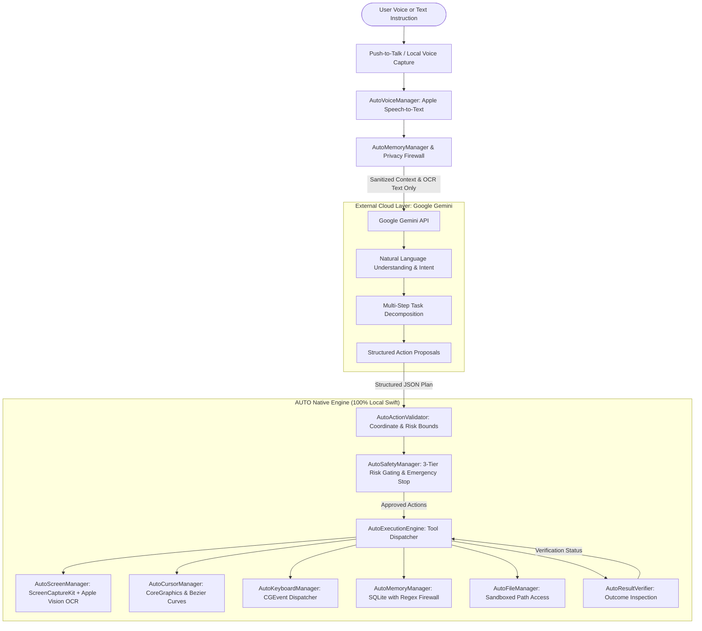

# AUTO Hybrid AI Architecture

## Overview

AUTO implements a strict **Hybrid AI Architecture** designed for high-performance macOS automation, privacy preservation, and intelligent reasoning.

The core architecture strictly separates high-level language comprehension and reasoning from local execution:

$$\text{User Instruction} \longrightarrow \underbrace{\text{Google Gemini (Reasoning \& Understanding)}}_{\text{External Cloud API}} \longrightarrow \underbrace{\text{AUTO Native Engine (All Execution)}}_{\text{100\% Local Swift on macOS}}$$

---

## Architectural Principles

1. **Google Gemini = Natural Language Understanding and Reasoning Only**:
   - Google Gemini is utilized exclusively for instruction interpretation, intent classification, multi-step workflow planning, and clarification.
   - Gemini never executes shell scripts, never sends raw mouse/keyboard events, and never acts as an unvetted runtime.

2. **AUTO Native Engine = All Local Operations & Execution**:
   - 100% of desktop interactions, mouse clicks, keystrokes, window focus, ScreenCaptureKit frames, Vision OCR text extraction, SQLite memory storage, and file manipulations are performed natively by Swift system frameworks on macOS.

3. **Zero Mandatory Local LLM**:
   - AUTO does not burden user laptops with gigabytes of heavy local neural network weights or high battery drain. Simple fixed tasks run deterministically offline, while complex planning leverages Google Gemini.

4. **Zero-Screenshot Privacy Gate**:
   - By default, AUTO extracts on-screen text using **Apple Vision OCR** (`VNRecognizeTextRequest`) locally on-device.
   - Text descriptions and bounding boxes are shared with Gemini; raw image pixels are never transmitted unless the user explicitly enables visual transmission in settings.

5. **Instant Emergency Stop (<10ms)**:
   - A hardware-level failsafe halts all running tasks, immediately releases mouse buttons and modifier keys, and latches execution to prevent unintended actions.

---

## Service Responsibilities Breakdown

| Layer | Component | Implementation | Primary Responsibility |
| :--- | :--- | :--- | :--- |
| **Reasoning** | Google Gemini API | `GeminiProvider.swift` | Instruction parsing, step planning, structured action generation |
| **Execution** | `AutoExecutionEngine` | `AutoExecutionEngine.swift` | Dispatches tools and coordinates execution lifecycle |
| **Execution** | `AutoToolRegistry` | `AutoToolRegistry.swift` | Catalog of 16+ built-in modular local tools across 6 categories |
| **Validation** | `AutoActionValidator` | `AutoActionValidator.swift` | Coordinate bounds clamping, parameter checks, command injection prevention |
| **Safety** | `AutoSafetyManager` | `AutoSafetyManager.swift` | 3-tier risk gating, user modal confirmations, emergency stop |
| **Voice** | `AutoVoiceManager` | `AutoVoiceManager.swift` | Apple Speech recognition, AVSpeechSynthesizer, offline commands |
| **Screen** | `AutoScreenManager` | `AutoScreenManager.swift` | ScreenCaptureKit capture and Apple Vision OCR on-device |
| **Cursor** | `AutoCursorManager` | `AutoCursorManager.swift` | Cubic Bezier curves, micro-jitters, hardware clicks |
| **Keyboard** | `AutoKeyboardManager` | `AutoKeyboardManager.swift` | CGEvent keystrokes and hotkey combinations |
| **Memory** | `AutoMemoryManager` | `AutoMemoryManager.swift` | SQLite on-device storage with regex sensitive data firewall |
| **Files** | `AutoFileManager` | `AutoFileManager.swift` | Sandboxed access to Desktop, Downloads, and Documents |
| **Tasks** | `AutoTaskManager` | `AutoTaskManager.swift` | Step dependency management and task progress tracking |
| **Verification**| `AutoResultVerifier` | `AutoResultVerifier.swift` | Visual and Accessibility outcome inspection post-action |

---

## Comparison: AUTO Hybrid vs. Legacy Cloud Desktop Agents

| Feature | Legacy Cloud Agents | AUTO Hybrid Architecture |
| :--- | :--- | :--- |
| **Vision Processing** | Cloud upload of 4K screen images every turn | On-device Apple Vision OCR; zero image upload by default |
| **Execution Engine** | Remote server scripts / Python subprocesses | Native macOS AppKit, CoreGraphics, ScreenCaptureKit |
| **Input Latency** | Network round-trip (500ms - 2000ms per event) | Native macOS event stream (<5ms cursor, <10ms emergency stop) |
| **Credential Safety** | API keys and session tokens stored on remote servers | macOS Keychain Services (`kSecClassGenericPassword`) |
| **Local Memory** | Cloud database sync | Local on-device SQLite database with sensitive credential filter |
| **Offline Capability** | Non-functional without internet | Local screen OCR, voice commands, mouse/keyboard, memory fully functional |
