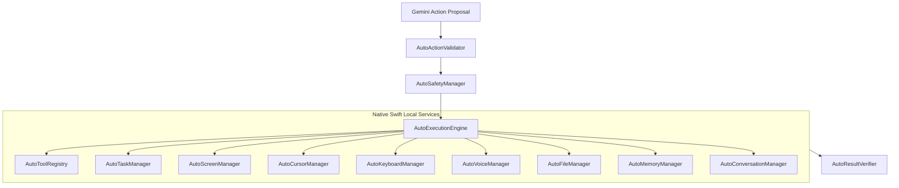

# AUTO Native Local Execution Engine

## Overview

The **AUTO Native Engine** is a comprehensive suite of 13 modular, native Swift services running directly on macOS. It manages all hardware events, screen analysis, voice input/output, file access, and risk gating locally without remote reliance.

---

## The 13 Native Local Engine Services

### 1. `AutoExecutionEngine`
- **Location**: [`AUTO/LocalEngine/AutoExecutionEngine.swift`](file:///Users/ketanbaba/Desktop/Extra/AUTO/AUTO/LocalEngine/AutoExecutionEngine.swift)
- **Role**: Central coordinator for all local operations. Receives validated proposals, verifies safety clearance with `AutoSafetyManager`, coordinates tool execution through `AutoToolRegistry`, and triggers post-execution verification with `AutoResultVerifier`.

### 2. `AutoToolRegistry`
- **Location**: [`AUTO/LocalEngine/AutoToolRegistry.swift`](file:///Users/ketanbaba/Desktop/Extra/AUTO/AUTO/LocalEngine/AutoToolRegistry.swift)
- **Role**: Maintains a dynamic, thread-safe catalog of 16+ built-in modular tools across 6 operational domains:
  1. *Conversation*: `speak_response`, `request_clarification`, `display_notification`
  2. *Screen Intelligence*: `capture_screen`, `perform_local_ocr`, `inspect_active_window`
  3. *Desktop Automation*: `move_cursor`, `click_element`, `type_keyboard_text`, `press_hotkey`, `scroll_window`
  4. *Application Context*: `list_running_applications`, `activate_application`
  5. *Memory*: `store_local_memory`, `search_local_memory`
  6. *Local File Operations*: `list_directory`, `read_text_file`

### 3. `AutoActionValidator`
- **Location**: [`AUTO/LocalEngine/AutoActionValidator.swift`](file:///Users/ketanbaba/Desktop/Extra/AUTO/AUTO/LocalEngine/AutoActionValidator.swift)
- **Role**: Pre-execution security filter. Validates coordinate bounds against active `NSScreen` dimensions, detects dangerous shell commands (`rm -rf`, `sudo`, `curl | sh`), clamps negative display coordinates accurately, and assigns the correct risk level.

### 4. `AutoTaskManager`
- **Location**: [`AUTO/LocalEngine/AutoTaskManager.swift`](file:///Users/ketanbaba/Desktop/Extra/AUTO/AUTO/LocalEngine/AutoTaskManager.swift)
- **Role**: Manages multi-step workflow plans, tracks step dependencies, executes sequential steps, and provides real-time progress callbacks to the UI.

### 5. `AutoMemoryManager`
- **Location**: [`AUTO/LocalEngine/AutoMemoryManager.swift`](file:///Users/ketanbaba/Desktop/Extra/AUTO/AUTO/LocalEngine/AutoMemoryManager.swift)
- **Role**: Local SQLite database (`import SQLite3`) storing user preferences, task history, and persistent facts. Includes an automated regex firewall that blocks storage of private keys, API tokens, passwords, and sensitive credentials.

### 6. `AutoConversationManager`
- **Location**: [`AUTO/LocalEngine/AutoConversationManager.swift`](file:///Users/ketanbaba/Desktop/Extra/AUTO/AUTO/LocalEngine/AutoConversationManager.swift)
- **Role**: Thread-safe manager for conversational turns. Prunes history to stay within token budgets and prepares sanitized contextual summaries for reasoning turns.

### 7. `AutoScreenManager`
- **Location**: [`AUTO/LocalEngine/AutoScreenManager.swift`](file:///Users/ketanbaba/Desktop/Extra/AUTO/AUTO/LocalEngine/AutoScreenManager.swift)
- **Role**: High-performance screen capture utilizing macOS `ScreenCaptureKit` and on-device text recognition using `VNRecognizeTextRequest` from the Apple Vision framework.

### 8. `AutoCursorManager`
- **Location**: [`AUTO/LocalEngine/AutoCursorManager.swift`](file:///Users/ketanbaba/Desktop/Extra/AUTO/AUTO/LocalEngine/AutoCursorManager.swift)
- **Role**: Controls the mouse cursor using native CoreGraphics APIs (`CGEvent`). Implements natural human-like movements via cubic Bezier curves with micro-jitters, smooth acceleration, and reliable click simulation.

### 9. `AutoKeyboardManager`
- **Location**: [`AUTO/LocalEngine/AutoKeyboardManager.swift`](file:///Users/ketanbaba/Desktop/Extra/AUTO/AUTO/LocalEngine/AutoKeyboardManager.swift)
- **Role**: Native keyboard typing and hotkey execution using `CGEventSource` and virtual keycodes. Prevents destructive key combinations unless explicitly confirmed.

### 10. `AutoVoiceManager`
- **Location**: [`AUTO/LocalEngine/AutoVoiceManager.swift`](file:///Users/ketanbaba/Desktop/Extra/AUTO/AUTO/LocalEngine/AutoVoiceManager.swift)
- **Role**: Native macOS voice engine using `AVFoundation`, Apple `SFSpeechRecognizer`, and `AVSpeechSynthesizer`. Supports global push-to-talk (holding the Control key) and instant speech interruption upon pressing Control again.

### 11. `AutoFileManager`
- **Location**: [`AUTO/LocalEngine/AutoFileManager.swift`](file:///Users/ketanbaba/Desktop/Extra/AUTO/AUTO/LocalEngine/AutoFileManager.swift)
- **Role**: Sandboxed file manager restricted strictly to safe user folders (`~/Desktop`, `~/Downloads`, `~/Documents`). Blocks access to sensitive directories (`~/.ssh`, `~/.aws`, system libraries) and prohibits dangerous file extensions.

### 12. `AutoSafetyManager`
- **Location**: [`AUTO/LocalEngine/AutoSafetyManager.swift`](file:///Users/ketanbaba/Desktop/Extra/AUTO/AUTO/LocalEngine/AutoSafetyManager.swift)
- **Role**: Enforces 3-tier risk gating (Low, Medium, High). Gathers explicit modal consent for High-Risk operations (such as file modifications or destructive actions) and manages an instantaneous Emergency Stop mechanism (<10ms).

### 13. `AutoResultVerifier`
- **Location**: [`AUTO/LocalEngine/AutoResultVerifier.swift`](file:///Users/ketanbaba/Desktop/Extra/AUTO/AUTO/LocalEngine/AutoResultVerifier.swift)
- **Role**: Validates action execution by comparing UI state before and after action dispatch (via `NSWorkspace` running apps and Accessibility hierarchy).
